<h1 align="center">Evann Rabeau</h1>

  

  Bridging cognitive science with computational methods and real-world systems. 
  Founder of <a href="https://evannr.github.io/personal_website/labconnect.html"><b>LabConnect</b></a>, computational support and open-science tooling for research labs.

  
  
  

---

### Research

| Project | Lab | What it does |
|---|---|---|
| **Open-world optimal stopping** · [`open_world`](https://github.com/EvannR/open_world) | Paris Brain Institute (ICM) | How people decide when to stop sampling when the number of options is unknown. Bayesian optimal-stopping model solved by backward induction. |
| **Empathy in multi-agent RL** · [`ISIR`](https://github.com/EvannR/ISIR) | ISIR, Sorbonne Université | The role of empathy in resource sharing and pro-environmental behaviour, through multi-agent RL simulations. |
| **Speech graphs for schizophrenia** | PREDIS × CERVO, Université Laval | End-to-end clinical pipeline: transcription, annotation, NLP and graph theory on speech. |
| **Predictive coding of language** | Kuperberg Lab, Harvard Medical School | Hierarchical predictive-coding models reproducing N400 and P600 in language comprehension. |

### Toolbox

  

### Contribution forest

  <picture>
    <source media="(prefers-color-scheme: dark)" srcset="https://raw.githubusercontent.com/EvannR/EvannR/output/forest-dark.svg"?v=2>
    
  </picture>

Each tree is a day of contributions. The forest grows, is harvested, and regenerates, a small nod to my work on common-pool resources.

